# SME ERP — Live Demo

A complete business-management system for small and medium-sized companies:
customers, products, sales, purchasing, stock, invoicing, payments, double-entry
accounting, reports and HR — in one fast, modern web app.

### 👉 [Open the live demo: erp.aliahad.com](https://erp.aliahad.com)

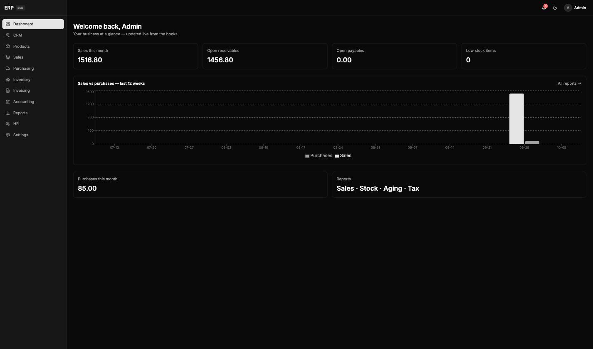

---

## Demo logins

Sign in at **[erp.aliahad.com](https://erp.aliahad.com)** with any account below.
Each role sees a different app — try two or three to see how permissions work.

| Role | Email | Password | What this person can do |
|---|---|---|---|
| Accountant | `accountant@example.com` | `dc920aa1846e` | Invoices, payments, journal, trial balance, reports |
| Sales | `sales@example.com` | `dc920aa1846e` | Customers, quotations, sales orders, customer invoices |
| Purchasing | `purchasing@example.com` | `dc920aa1846e` | Suppliers, purchase orders, goods receipts |
| Warehouse | `warehouse@example.com` | `dc920aa1846e` | Stock, receipts, deliveries, stock adjustments |
| HR | `hr@example.com` | `dc920aa1846e` | Employees, leave types, approve or reject leave |
| Viewer | `viewer@example.com` | `dc920aa1846e` | Read-only access across the whole system |
| Employee | `employee@example.com` | `dc920aa1846e` | Self-service: request and track their own leave |

> **This is a shared demo.** Other visitors use the same accounts, so data you
> see may change and may be reset at any time. Please don't enter real
> personal or company information. The operator account is private. Invoice email
> runs in test mode without delivering messages to recipients.

---

## A 5-minute tour

Follow a sale from order to books using the demo roles:

1. **Viewer** opens the dashboard to see sales, open balances and low stock.
2. **Sales** creates and confirms a sales order for a customer.
3. **Warehouse** posts a delivery from the order. The app reduces stock and books
   the cost of goods sold.
4. **Sales** creates a draft invoice from the order. **Accountant** posts it and
   records the payment.
5. **Accountant** opens the journal and trial balance to inspect the postings.
6. **HR** can approve or reject leave. **Employee** can request and view their own
   leave.

---

## What's inside

| Area | Highlights |
|---|---|
| **CRM** | One list of customers and suppliers (a company can be both), payment terms, default currency, tags |
| **Products** | Goods and services, categories, units, tax rates, optional AI-drafted descriptions\* |
| **Sales** | Quotations that convert to orders, sales orders with partial delivery and partial invoicing |
| **Purchasing** | Purchase orders, goods receipts, supplier bills — bills can arrive before or after the goods |
| **Inventory** | Multiple warehouses, moving-average costing, deliveries, receipts, adjustments, low-stock alerts |
| **Invoicing** | Customer invoices, supplier bills, credit notes, refunds, payments, on-account payments, invoice email |
| **Accounting** | Automatic double-entry bookkeeping, chart of accounts, journal, ledger, trial balance, manual entries |
| **Multi-currency** | Invoice in any currency; exchange-rate gains and losses are booked automatically on payment |
| **Reports** | Dashboard, sales and purchase analysis, stock valuation, receivables/payables aging, tax summary, optional AI summary\* |
| **HR** | Employees, leave types and allowances, working-day leave requests, approve / reject, employee self-service |
| **Administration** | Users, roles and 84 fine-grained permissions, organization profile, numbering, currencies, full audit log |

\* AI features connect to an AI provider and are switched off in this public
demo; they show a "disabled" notice when clicked.

**Built to be trusted with money:** posted documents can't be edited, only
reversed; every amount is exact decimal arithmetic; each document and its
journal entry are saved together or not at all; every change is audit-logged.

---

## Screenshots

| | |
|---|---|
| 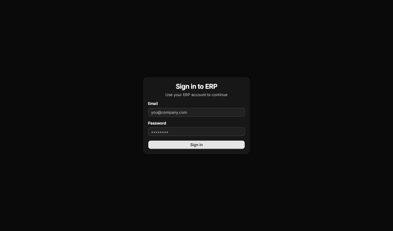 **Sign in** |  **Dashboard** |
| 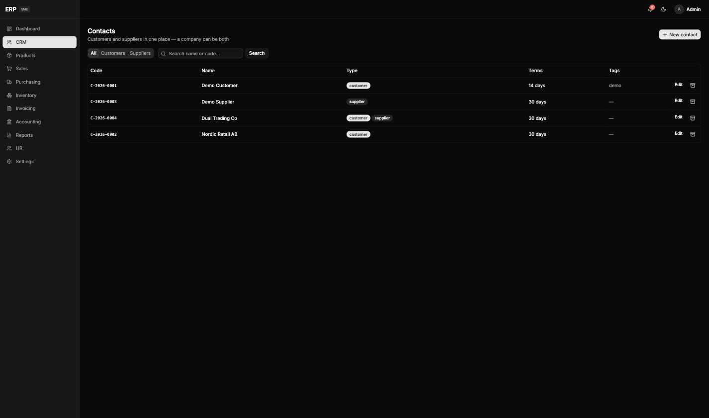 **CRM — customers & suppliers** | 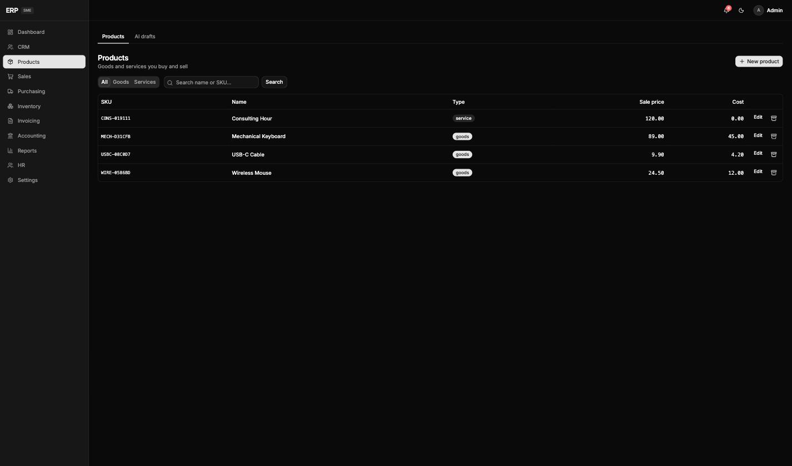 **Products & services** |
| 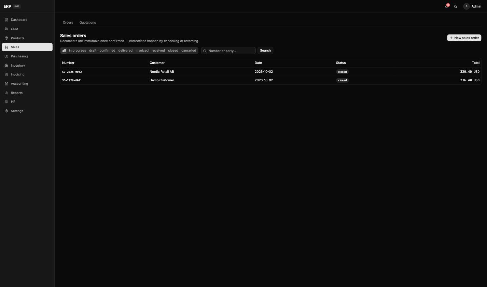 **Sales orders** | 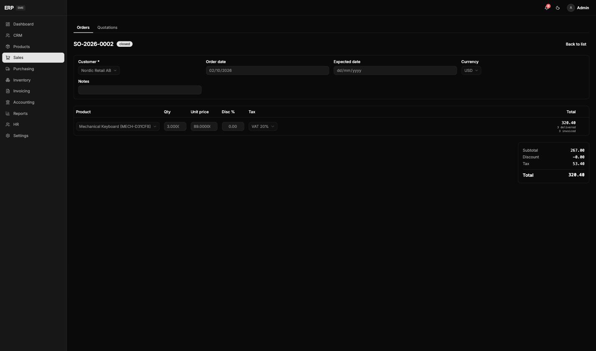 **Order with delivery & invoicing progress** |
| 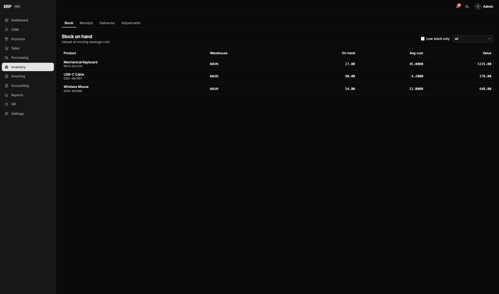 **Stock on hand, valued at average cost** | 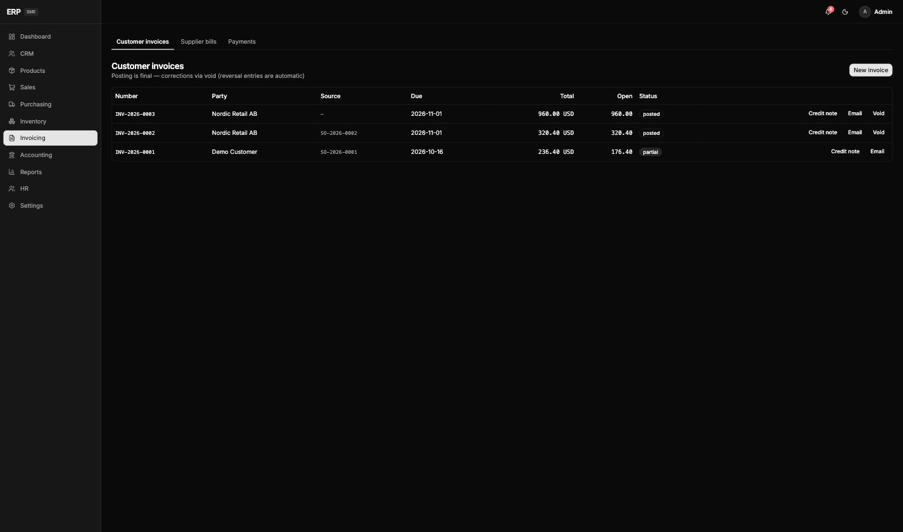 **Invoices with open balances, credit notes, email** |
|  **Automatic journal entries** | 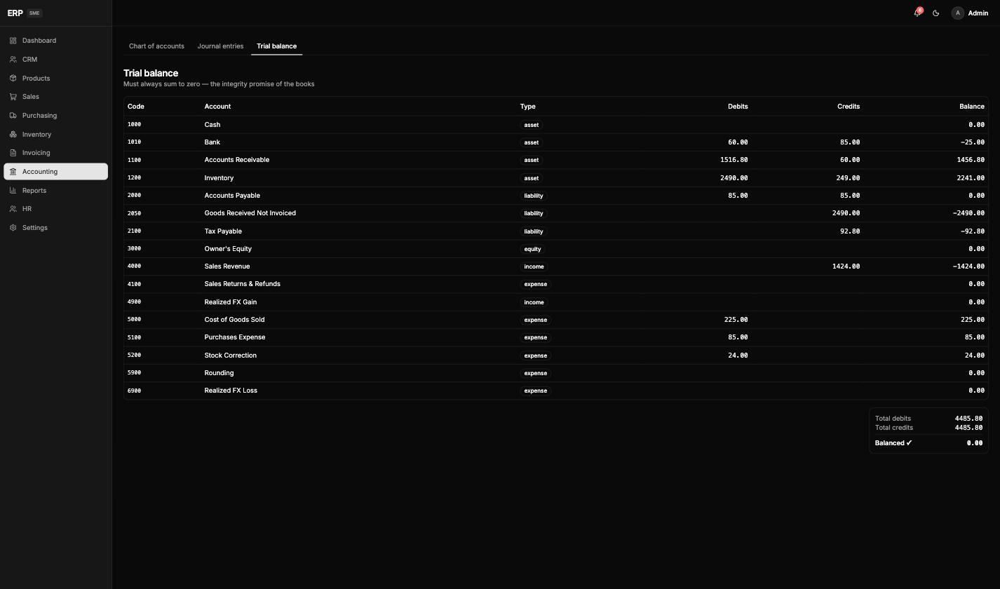 **Trial balance — always balanced** |
| 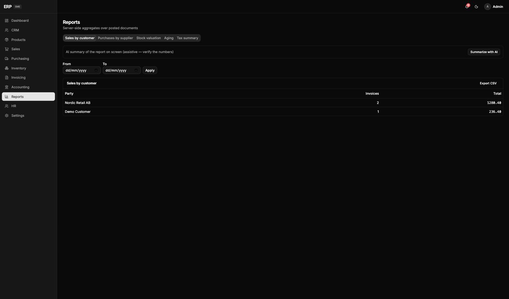 **Reports with CSV export** | 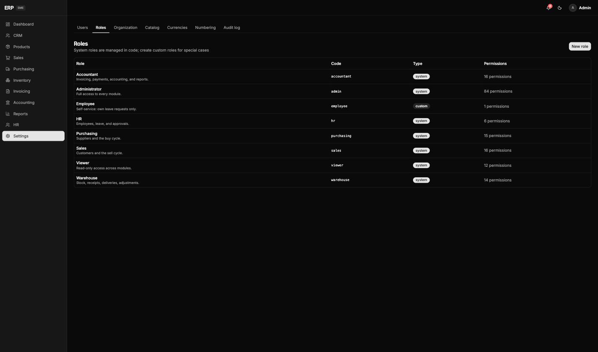 **Roles & permissions** |

---

## Technology

The public demo serves React and Vite from Cloudflare Workers Static Assets.
Python Workers run FastAPI and Pydantic with typed D1 repositories. Durable
Objects coordinate writes, Queues and Cron handle jobs, and private R2 stores
nightly backups. Releases use the Cloudflare CLI.
[Cloudflare developer guide](docs/CLOUDFLARE_DEVELOPMENT.md)
