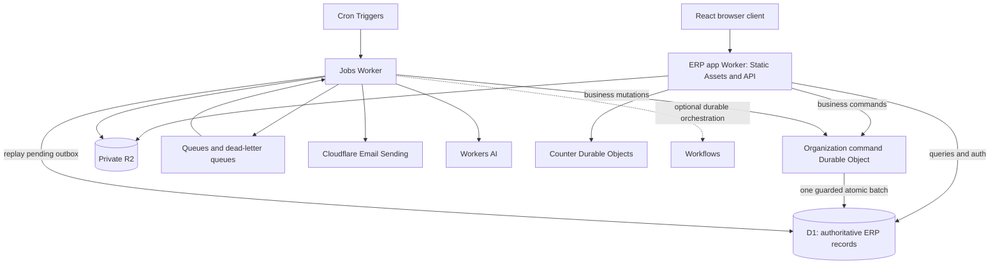

# ERP migration to Cloudflare: research and proposed architecture

**Research date:** 12 November 2026. **Status updated:** 14 November 2026 (UTC+08:00). Implementation is in progress: the basic Python/D1 proof, authentication, core/master data, accounting, orders/quotations, inventory, invoicing/payments, HR, reporting, Queue/Cron notifications, Workers AI and full exact R2/D1 recovery pass isolated staging checks. All original HTTP operations are present. Evidence includes a complete buy/sell/pay and reversal cycle, consistent paged reporting, dead-letter replay, reviewable AI generation with a shared budget, recovery of 6,591 rows across all 62 data tables, and scheduled backup/retention/archive-import checks. Workers Static Assets now serves the existing React UI; browser sign-in, reload, navigation and contact create/edit/archive checks pass. A fresh isolated demo now passes exact stock/open-balance checks and 112 API role/ownership checks; its administrator dashboard renders those totals in Chrome. Chrome role navigation now passes 98 page checks and 31 permitted form openings across all nine active demo profiles, and the same-browser account-switch test isolates employee leave from the previous administrator cache. The shared quality gate passes 309 backend and 30 frontend tests, and the hosted workflow is prepared. Live mail, realistic recovery/capacity acceptance, full browser/role parity, hosted CI activation and cutover acceptance remain open; see [implementation evidence and outstanding work](CLOUDFLARE_IMPLEMENTATION.md).

**Confirmed scope:** replace the Docker/VPS runtime with Cloudflare services, use D1 instead of PostgreSQL, replace Redis/arq, and use R2 instead of SeaweedFS/S3. A **fresh demo database is acceptable**, as confirmed during this investigation. Preserve the ERP's functionality and financial rules; retaining the existing demo records and password hashes is unnecessary.

## 1. Recommendation

Use **Python Workers + FastAPI/Pydantic with typed native D1 repositories**, retaining the existing React/Vite frontend on Workers Static Assets. The infrastructure target remains one D1 database for the company's business records, R2, Queues, Cron Triggers, and narrowly scoped Durable Objects. Python retention preserves validation contracts and Decimal-based business logic. This is the architecture now being implemented and verified in isolated staging; TypeScript/Hono remains an alternative only if later Python runtime acceptance fails. A language rewrite is not required by Cloudflare. [Python Workers](https://developers.cloudflare.com/workers/languages/python/), [FastAPI support](https://developers.cloudflare.com/workers/languages/python/packages/fastapi/)

The optional ORM candidate is **synchronous SQLAlchemy 2 with the community `sqlalchemy-cloudflare-d1` adapter**, using the native D1 binding. Its basic proof covers reads and suitable individual statements; the application does not depend on it. Operations that require multiple changes to commit together use a dedicated native D1 batch path. Broader adapter adoption would require further runtime, concurrency, type-mapping, and maintenance review. [Adapter documentation](https://github.com/CollierKing/sqlalchemy-cloudflare-d1), [adapter package/status](https://pypi.org/project/sqlalchemy-cloudflare-d1/)

The basic runtime proof has passed. The application now uses typed native D1 repositories for reads and writes, reusing the original Pydantic contracts and generated model metadata. SQLAlchemy remains a validated adapter option rather than the application's transaction mechanism. This is a persistence choice within the recommended Python architecture; see [the implementation log](CLOUDFLARE_IMPLEMENTATION.md#core-management-and-master-data).

Use Cloudflare Email Sending for transactional mail, subject to its current beta onboarding and limits. Add Workflows only when a process actually needs durable multi-step execution. Workers AI can replace the current externally hosted model inference after quality testing.

Keep the modular monolith: CRM, catalog, sales, purchasing, inventory, invoicing, accounting, HR, and core remain business modules. Separate public HTTP, background processing, and command coordination as execution entrypoints; do not turn each module into an independent database or microservice.

**D1 remains a conditional fit for the full ERP.** It provides atomic SQL batches, but its API, concurrency model, integer transport, and database limits require deliberate changes. The isolated financial proof now passes exact-value transport, guarded rollback, competing-stock commands, idempotent replay and bounded R2/D1 recovery checks. That evidence supports continuing the port; it does not establish full workflow parity, restart resilience, realistic capacity or production-scale recovery. See [observed remote evidence](CLOUDFLARE_IMPLEMENTATION.md#observed-remote-evidence). [D1 batch API](https://developers.cloudflare.com/d1/worker-api/d1-database/), [D1 limits](https://developers.cloudflare.com/d1/platform/limits/)

## 2. What the existing application requires

The inspected revision is `ad7f268`. The backend contains 84 Python source files, approximately 11,729 source lines, 45 modeled tables, 18 Alembic migrations, and 16 backend test files. These counts describe the scope of the port, not an effort estimate.

The important existing contracts are:

- A posted document and its journal entry commit together. `api/app/shared/events.py` distinguishes transactional accounting handlers from after-commit notifications.
- Orders, inventory, and allocations use PostgreSQL row locks to protect quantities and balances. See `shared/order_flow.py`, `modules/inventory/service.py`, and `modules/invoicing/service.py`.
- Money uses Python Decimal and PostgreSQL NUMERIC, with half-even rounding; quantities have four decimal places, prices six, and FX rates eight.
- Sales and purchasing share an order engine. Partial billing and goods movement can happen in either order. Reversals restore both the books and document progress.
- Redis currently serves several different purposes: arq jobs, refresh-token revocation, login failure counters, AI budgets, reminder deduplication, and worker heartbeat state. These need different replacements.
- The React client already uses decimal strings at the API boundary and BigInt for important money calculations. Preserve its route and response contracts where practical.
- S3 currently primarily supports backups. Product image metadata exists, but a complete attachments/upload feature is not implemented; infrastructure migration should not silently expand into building that feature.

Primary repository references: [developer guide](DEVELOPMENT.md), [transaction events](../api/app/shared/events.py), [accounting postings](../api/app/modules/accounting/postings.py), [money rules](../api/app/shared/money.py), [frontend money helpers](../web/src/lib/money.ts), [current jobs](../api/app/jobs/__init__.py).

## 3. Service replacement map

| Current component | Proposed target | Decision |
|---|---|---|
| VPS, Docker Compose, uvicorn | Cloudflare Workers | Stateless HTTP and event execution; no always-running application server |
| nginx serving the React build | Workers Static Assets | Retain React, Vite, React Router, Tailwind, shadcn, and TanStack Query |
| FastAPI/Pydantic API | Python Worker running FastAPI/Pydantic | Implemented staging path; retain API contracts and remove the uvicorn server dependency |
| Async SQLAlchemy + asyncpg | Typed native D1 repositories; optional synchronous SQLAlchemy 2 adapter | Native batches own atomic commands; the adapter passes the basic proof, but ORM commit/rollback does not provide multi-statement atomicity |
| PostgreSQL | D1 | One business database per environment for the current company; table prefixes retain module ownership |
| Alembic | Versioned D1 SQL migrations | Build a clean final schema and new demo seed |
| arq queue + Redis broker | Queues + queue consumer Worker | Durable async delivery, bounded retries, dead-letter queues, idempotent consumers |
| arq cron | Cron Triggers | Trigger bounded scans and enqueue work |
| Future long-running orchestration | Workflows | Optional for multi-step imports, large exports, or external approval waits |
| Redis login/AI counters | Durable Objects | Strongly coordinated counters; approximate edge limits can supplement them |
| Redis refresh-token revocation | D1 session/refresh-token records | Primary reads and atomic conditional rotation; no KV-based revocation |
| SeaweedFS S3 | R2 | Private files, exports, and exact logical backups |
| SMTP server/client | Cloudflare Email Sending | Current sending service, with domain verification and beta caveats |
| OpenRouter inference | Workers AI | Evaluate a suitable model for descriptions/summaries; preserve explicit review and disabled/error states |
| Future pgvector search | Vectorize + Workers AI embeddings | Optional future feature; the current app only has keyword product search |
| Host cron deployment polling | Workers Builds | Build/test before deployment; separate staging and production resources |
| Container logs and heartbeat | Workers Logs/Traces and service metrics | Observe errors, queue lag, dead letters, D1 latency, and scheduled-job completion |
| Host `.env` secrets | Workers secrets/bindings | No secrets in Vite variables, source control, or public responses |
| Tunnel to VPS | Workers Custom Domain and managed HTTPS | Remove the origin-server dependency after cutover |

Cloudflare recommends Workers Static Assets for application hosting. Queues, Cron, Workflows, R2, D1, and Durable Objects have different responsibilities; there is no need to replace Redis with another single general-purpose server. Python can access D1 through the native Worker binding. [Static Assets](https://developers.cloudflare.com/workers/static-assets/), [storage choices](https://developers.cloudflare.com/workers/platform/storage-options/), [D1 from Python](https://developers.cloudflare.com/d1/examples/query-d1-from-python-workers/)

## 4. Proposed topology

Use one public origin. Serve built static assets directly; route `/api/*` to the API before SPA fallback. API errors must remain JSON rather than returning `index.html`. Financial records, authorization responses, and personalized reports should not enter shared public caches. Start without a separate business-data cache or read replicas; add them only after measurements justify their consistency and invalidation costs.

Suggested source organization retains `web/` and adapts `api/` for Python Worker application/jobs entrypoints and D1 repositories. Preserve the existing Python domain modules and Decimal helpers where compatible; generate frontend contracts from the API schema. Keep explicit module ownership in the source tree. D1 schema/migration files replace the PostgreSQL migration path for the new deployment; the old deployment can remain a rollback reference until retirement.

## 5. D1 transaction design: the essential change

### Keep one transaction boundary

Put all related sales, stock, invoicing, accounting, numbering, audit, idempotency, and outbox tables in the same D1 database. A database per business module would break operations that must commit together. Splitting future independent companies into separate databases is a different, potentially useful design; it does not make the current application multi-tenant automatically.

D1 `batch()` rolls back its statements if one fails. It does not provide the existing SQLAlchemy pattern of reading intermediate results, running arbitrary Python code, and continuing the same open transaction. D1 Sessions/bookmarks address read consistency, not interactive transaction scope. [D1 database API](https://developers.cloudflare.com/d1/worker-api/d1-database/), [Sessions and replication](https://developers.cloudflare.com/d1/best-practices/read-replication/)

The evaluated `sqlalchemy-cloudflare-d1` release, 0.4.1, supplies synchronous binding integration, but its `SyncWorkerConnection.commit()` and `rollback()` are no-ops. Its `executemany()` executes individual statements rather than building an atomic D1 batch. An ORM session, flush, or transaction context must therefore never be treated as the commit boundary for document/journal/audit/outbox changes. Apply this rule to every multi-statement atomic operation, including master-data changes with audit records. [Inspected release source](https://github.com/CollierKing/sqlalchemy-cloudflare-d1/blob/7b127f4d14895392151a6eeb2e031f4051598041/src/sqlalchemy_cloudflare_d1/connection.py)

### Coordinate commands and enforce them in SQL

For this single-company ERP, use one organization command Durable Object to coordinate related business writes. This makes stock, allocation, credit-cap, numbering, and order-progress races easier to reason about. All financial writers, including jobs and maintenance/import tools, must follow the same path. Changes to inputs that determine posting—taxes, FX rates, account mappings, and product attributes—must also use that path, or their revisions must be validated inside the financial batch. Reads can go directly to D1.

A proposed command proceeds as follows:

1. Authenticate, authorize, and validate the command and its idempotency key. Bind that key to the actor, operation, and request hash.
2. Enter an explicitly serialized coordinator section, read authoritative current state, and calculate the intended document, progress, stock valuation, and balanced journal using exact arithmetic.
3. Build one D1 batch containing SQL-enforced state/revision guards, uniqueness and balance checks, all business changes, journal lines, audit, command result, and outbox records.
4. Return the result only after that batch commits. A repeated key returns the recorded result; the same key with different input is rejected.
5. Dispatch notifications, mail, and AI work from the outbox after commit. These side effects never determine whether an invoice's accounting exists.

**A Durable Object is not a distributed database transaction.** Its local transactions do not include D1. Requests can interleave across external async calls unless explicitly prevented. The implementation uses an explicit per-object command mutex across D1 awaits, rather than broadly blocking all object I/O. Keep the critical section short, catch expected conflicts, and do not call mail, AI, or R2 inside it. D1 constraints and idempotency must still survive object restart or a lost response after commit. [Durable Object state](https://developers.cloudflare.com/durable-objects/api/state/), [local storage transaction scope](https://developers.cloudflare.com/durable-objects/api/sqlite-storage-api/)

**A zero-row conditional update is not an error.** A batch that updates no stock row can still insert journal rows unless the SQL plan prevents that. Checking affected-row counts in application code after the batch has committed is insufficient. A failed precondition must produce a real SQL failure within the batch, or an equivalently proven all-or-nothing gated plan. This is an application design requirement, not a guarantee supplied by an ORM. [SQLite UPDATE semantics](https://www.sqlite.org/lang_update.html)

Start with the primary for all command and authorization reads. If replica reads are introduced later, use Sessions/bookmarks for read-your-writes and retain write-side guards. No replica, queue, or cache becomes the authority for money or permissions.

## 6. Preserve financial precision

Declaring `DECIMAL(18,2)` in SQLite does not reproduce PostgreSQL NUMERIC. Also, D1's JavaScript API does not support binding BigInt directly; default integer results use Number. Python Workers access these bindings through language interop, so retaining Python Decimal or arbitrary-precision integers does not by itself prove exact transport through D1 or an ORM adapter. [SQLite types](https://www.sqlite.org/datatype3.html), [D1 type conversion](https://developers.cloudflare.com/d1/worker-api/#type-conversion), [Python interop](https://developers.cloudflare.com/workers/languages/python/ffi/)

Recommended design to validate:

- Store scaled coefficients in signed-64-bit SQLite INTEGER columns: money scale 2, quantities 4, prices 6, FX rates 8, plus explicit scales for tax percentages and leave days.
- Retain Python Decimal for financial calculations and use Python integers for scaled coefficients. Every valid existing NUMERIC(18,s) coefficient fits signed 64-bit storage, although it may exceed JavaScript Number's safe range.
- Bind canonical integer strings and cast them in SQL; project financial integers back as text. Validate a dedicated adapter/type mapping instead of relying on default ORM Numeric or float conversions.
- Validate precision, scale, and range before SQL casts. SQLite may clamp out-of-range casts or promote overflowing arithmetic to floating point.
- Calculate multiplication, division, FX, moving averages, and half-even rounding with Decimal or exact integer arithmetic in Python, with sufficient calculation precision. Preserve the current per-line rounding order and residual-allocation rules. Retain the existing FX convention: the stored rate is document-currency units per one base-currency unit, so conversion to base divides by that rate.
- Guard aggregate range independently. A SQL sum can overflow even when every individual value is valid; use bounded rollups or paged exact Python accumulation where required. Preserve decimal strings in the external API. The existing frontend can keep its BigInt helpers; a TypeScript backend alternative would also need exact BigInt/decimal arithmetic.

The initial local in-memory SQLite check confirmed that an 18-digit string can round-trip through INTEGER/text casts, and demonstrated overflow clamping and promotion to REAL. Subsequent real Worker/D1 checks verify exact transport, invoice/payment amounts, inventory costs, reversals, report aggregates beyond int64 and bounded proof backup/restore; see [implementation evidence](CLOUDFLARE_IMPLEMENTATION.md). Production-scale backup/recovery and full-system capacity acceptance remain open. [SQLite expressions](https://www.sqlite.org/lang_expr.html), [aggregate behavior](https://www.sqlite.org/lang_aggfunc.html)

Retain and exercise the existing Python calculations and regression cases against the new runtime and persistence layer. If a TypeScript alternative is pursued, use those Python cases as its behavioral oracle. The fresh database removes data conversion work; it does not remove the need to preserve financial correctness.

## 7. Replace Redis/arq by responsibility

### Jobs, retries, and the outbox

Use Queues for email, bulk description generation, and bounded export/background tasks. Queues provides at-least-once delivery; consumers must tolerate duplicates and out-of-order delivery. Configure retry/backoff policy and dead-letter queues. Use stable event IDs, database uniqueness, per-consumer processing records, and revision checks. [Queue delivery guarantees](https://developers.cloudflare.com/queues/reference/delivery-guarantees/), [dead-letter queues](https://developers.cloudflare.com/queues/configuration/dead-letter-queues/)

Write the outbox row with the originating business transaction. A dispatcher sends pending rows to Queues and records progress; a scheduled sweep retries unsent rows. If sending succeeds but recording success fails, the event can be delivered again. Consumer idempotency handles that case. A database commit followed only by an unrecorded `queue.send()` or `waitUntil()` leaves a loss window.

Financial effects can be made idempotent in D1. An external mail send has a separate outcome: a crash after delivery but before recording success can produce a duplicate on retry. Use provider idempotency when available and record ambiguous outcomes; do not promise exactly-once external delivery or mark an email sent before sending it.

### Scheduling and orchestration

Replace the current scheduled jobs with Cron-triggered, bounded work: overdue scans, quotation expiry, audit retention, outbox dispatch/recovery, and backup scheduling. Fan out large scans through Queues. Remove Redis TTL cleanup and the always-running worker heartbeat; monitor actual scheduled completion and queue health instead.

Cron schedules are UTC. Configure the organization's business timezone explicitly for overdue dates and accounting periods; convert intended local send windows to UTC. Do not inherit a container's implicit timezone. Workflows is useful for resumable multi-step work, but ordinary reminders and single-step email jobs do not need it. Workflows does not create a distributed transaction across D1 and email/R2. [Cron Triggers](https://developers.cloudflare.com/workers/configuration/cron-triggers/), [Workflows](https://developers.cloudflare.com/workflows/)

### Authentication and counters

Preserve short-lived access tokens and Secure, HttpOnly refresh cookies. Store hashed refresh/session identifiers in D1 and rotate them using a conditional atomic update against authoritative state. Check active users and current RBAC permissions on the server. KV's eventual consistency makes it unsuitable as the sole authority for revocation, balances, stock, or exact budgets. [KV consistency](https://developers.cloudflare.com/kv/concepts/how-kv-works/)

Use Durable Objects for strict login failure windows and deployment-wide AI budgets; shard counters by the appropriate identity/key. Workers Rate Limiting and WAF/Turnstile can provide additional abuse controls, but local/approximate rate limiting is not an exact global quota. [Rate Limiting API](https://developers.cloudflare.com/workers/runtime-apis/bindings/rate-limit/)

The implementation retains `argon2-cffi` using verified PyEmscripten-compatible wheels. The fresh demo uses Argon2id with 19 MiB, two passes and one lane, 16-byte salts and 32-byte output. Native/WASM vector and password checks pass in the actual Python Worker; see [observed CPU and authentication evidence](CLOUDFLARE_IMPLEMENTATION.md#authentication-and-typed-repositories). These new parameters follow OWASP's minimum Argon2id recommendation. No legacy hashes are imported. Cloudflare Access remains optional for an internal workforce deployment; the ERP still enforces its own role permissions. [OWASP password storage](https://cheatsheetseries.owasp.org/cheatsheets/Password_Storage_Cheat_Sheet.html), [Python package compatibility](https://developers.cloudflare.com/workers/languages/python/packages/)

## 8. R2, email, AI, and operational services

**R2:** use private buckets, Workers bindings, and explicit authorization. Keep file metadata in D1 and bytes in R2. There is no joint transaction: use upload states, immutable/versioned object keys, reconciliation, and delayed cleanup for orphaned objects. Set retention separately for backups and generated exports. R2's strong consistency does not make cached public URLs instantly fresh. [R2 consistency](https://developers.cloudflare.com/r2/reference/consistency/), [R2 lifecycle](https://developers.cloudflare.com/r2/buckets/object-lifecycles/)

**Transactional email:** use the current Cloudflare Email Sending product rather than treating inbound Email Routing as an SMTP replacement. Sending is currently beta and requires sending-domain onboarding; account access, sender authentication, recipient restrictions, bounce handling, and quotas must be checked before enabling real recipients. Use test recipients or a sending-disabled mode for the shared demo. Email delivery failures must not undo posted documents. [Email Sending setup](https://developers.cloudflare.com/email-service/get-started/send-emails/), [Email limits](https://developers.cloudflare.com/email-service/platform/limits/)

**AI:** start with descriptions and report summaries through Workers AI, preserving explicit product-draft review, permission checks, budget limits, and graceful disabled/error behavior. Model output quality and availability need testing against existing examples. AI Gateway can add observability/control when an external provider is retained; it does not host that provider's model. Vectorize/embeddings are a separate future enhancement because real semantic search is not implemented today. [Workers AI models](https://developers.cloudflare.com/workers-ai/models/), [AI Gateway](https://developers.cloudflare.com/ai-gateway/), [Vectorize](https://developers.cloudflare.com/vectorize/)

**Delivery and observability:** use Workers Builds to build and test the frontend/backend, with isolated D1/R2/Queues/DO resources for staging and production. Keep Git as the source of truth; GitHub can remain the source host without remaining runtime infrastructure. Use least-privilege deployment credentials, Workers secrets, structured request/command/event IDs, and redacted logs. Monitor D1 query/row costs, failed commands, queue age/dead letters, stuck outbox rows, mail failures, and backup restoration. Cloudflare's current guidance selects the `cf` CLI for projects without existing Wrangler configuration; use that convention when implementation begins. [Workers Builds](https://developers.cloudflare.com/workers/ci-cd/builds/), [secrets](https://developers.cloudflare.com/workers/configuration/secrets/), [cf agent guidance](https://developers.cloudflare.com/cf/agents/)

## 9. Recovery and capacity

D1 Time Travel supplies point-in-time recovery with 30 days of history on Paid. Supplement it with exact logical backups in R2 and a rehearsed restore procedure. The existing pg_dump job must be replaced. Native D1 exports currently block other database requests and document a large-integer precision caveat; prove exact 18-digit export/restore rather than assuming the default dump preserves it. A fallback is a text-projected logical backup during a coordinated quiesced write window. [Time Travel](https://developers.cloudflare.com/d1/reference/time-travel/), [export limitations](https://developers.cloudflare.com/d1/best-practices/import-export-data/#known-limitations)

A recovery runbook must pause new writes and async side effects, restore consistent D1 data, reconcile referenced R2 versions, avoid replaying already delivered external effects, and deliberately expire/recreate sessions. Code rollback does not restore database data. R2 backups remain in the same provider/account failure domain; that is a residual tradeoff of the requested all-Cloudflare scope, not an independent disaster-recovery copy.

The D1 paid per-database cap is **10 GB**, and each primary database processes queries serially. Long reports compete with command traffic. Audit, stock moves, journal lines, outbox history, and indexes drive growth. Set capacity alerts and retention/headroom policies well before the cap; there is no supported increase to that single-database limit. This is unsuitable as an unqualified architecture for a very large or high-write enterprise ERP. [D1 limits](https://developers.cloudflare.com/d1/platform/limits/)

Do not solve a growing company's cap by separating its sales and ledger into different D1 databases without designing a new consistency model. If real workloads fail the proof, reconsider the database choice. The fallback with the least database-semantic change is Workers plus Hyperdrive and managed PostgreSQL, but PostgreSQL would be external to Cloudflare and therefore would not satisfy the requested fully Cloudflare-native data layer. Hyperdrive is a connector, not a PostgreSQL hosting service. [Hyperdrive](https://developers.cloudflare.com/hyperdrive/)

## 10. Language and ORM choice: evaluate Python first

Python Workers **supports FastAPI/ASGI and Pydantic**. Cloudflare documents synchronous SQLAlchemy support; the restriction is async SQLAlchemy because greenlet is unavailable. The current `AsyncSession`/asyncpg data layer cannot carry over unchanged. D1 also requires new schema, SQL, precision, and transaction handling. Native extensions, filesystem/process jobs, password hashing, and arq need individual replacements. [Python Workers](https://developers.cloudflare.com/workers/languages/python/), [FastAPI support](https://developers.cloudflare.com/workers/languages/python/packages/fastapi/), [SQLAlchemy compatibility](https://developers.cloudflare.com/hyperdrive/examples/python-workers/#sqlalchemy-support)

The community `sqlalchemy-cloudflare-d1` package documents `create_engine_from_binding()` for direct Worker binding access. Version 0.4.1 is marked alpha and uses Pyodide's `run_sync()` to bridge synchronous SQLAlchemy calls to async D1 operations. The isolated ERP proof now executes it inside FastAPI on Workers: concurrent native/ORM reads and single-statement ORM writes preserve exact 18-digit values through the custom scaled type. This establishes basic runtime viability, not production suitability or complete ERP parity. Continue validating dependency compatibility, request isolation and error behavior as modules are ported. Use the native D1 batch repository for atomic multi-statement writes. See the [observed implementation evidence](CLOUDFLARE_IMPLEMENTATION.md). [Adapter documentation](https://github.com/CollierKing/sqlalchemy-cloudflare-d1), [package status](https://pypi.org/project/sqlalchemy-cloudflare-d1/), [inspected adapter source](https://github.com/CollierKing/sqlalchemy-cloudflare-d1/blob/7b127f4d14895392151a6eeb2e031f4051598041/src/sqlalchemy_cloudflare_d1/connection.py)

| Option | Advantages | Costs and fit |
|---|---|---|
| Python/FastAPI/Pydantic + synchronous SQLAlchemy D1 adapter candidate | Preserve more endpoint structure, validation, models, and Decimal algorithms | Basic runtime proof passes; broader adapter suitability remains provisional, and atomic writes use native D1 batches |
| Python/FastAPI/Pydantic + direct D1 repositories | Retain Python business logic with explicit persistence and batch control | Current application implementation, preserving original contracts/metadata; requires explicit SQL/repository code |
| TypeScript/Hono + D1, optionally Drizzle for routine queries | Direct Workers bindings, shared frontend types and tooling | Alternative if Python proves unsuitable; requires porting financial domain logic and tests |
| Workers + Hyperdrive + managed PostgreSQL | Retain PostgreSQL semantics and broader capacity | External database remains; outside requested all-Cloudflare target |
| Cloudflare Containers | Can preserve more Linux runtime behavior | Retains containers and does not solve the D1 transaction port; outside the requested Workers-only approach |

The implementation now retains Python following a successful basic runtime proof. The wider ERP financial, recovery and capacity acceptance work remains open. Avoid adding SSR, a new frontend framework, or a visual redesign during infrastructure migration. Figma work can continue against the existing user workflows and design system.

## 11. Cost baseline and limits

These are public USD list prices checked on 12 November 2026, before taxes and account-specific terms. Included usage is shared at account level where applicable; existing Cloudflare projects may already consume it. They are not a quote for this ERP.

| Service | Current planning baseline |
|---|---|
| Workers Paid | $5/month minimum; 10 million dynamic requests and 30 million CPU-ms included; then $0.30/million requests and $0.02/million CPU-ms. Static asset requests are free. |
| D1 Paid | 25 billion rows read/month, 50 million rows written/month, 5 GB storage included; then $0.001/million read rows, $1/million written rows, $0.75/GB-month. |
| R2 Standard | $0.015/GB-month, $4.50/million Class A operations, $0.36/million Class B; includes a free allowance and no direct R2 egress fee. |
| Queues | Budget for write/read/delete operations and retries, not just one charge per logical job. |
| Durable Objects | Request, duration, and storage charges; a coordinator waiting for D1 can accrue duration even when little application CPU is used. |
| Email Sending | Paid currently includes 3,000 emails/month; then $0.35/1,000, subject to onboarding and service limits. |
| Builds, logs, AI, optional Workflows | Metered separately; AI model choice, build time, log volume, retries, and long-running steps affect cost. |

Sources: [Workers pricing](https://developers.cloudflare.com/workers/platform/pricing/), [D1 pricing](https://developers.cloudflare.com/d1/platform/pricing/), [R2 pricing](https://developers.cloudflare.com/r2/pricing/), [Queues pricing](https://developers.cloudflare.com/queues/platform/pricing/), [DO pricing](https://developers.cloudflare.com/durable-objects/platform/pricing/), [Email pricing](https://developers.cloudflare.com/email-service/platform/pricing/), [Build pricing](https://developers.cloudflare.com/workers/ci-cd/builds/limits-and-pricing/).

A small demo could stay close to the Workers minimum plus modest service usage, but no reliable total follows from user count alone. For illustration, 100,000 API calls at 10 ms CPU each use 1 million CPU-ms, within the Workers included CPU amount; D1, DO, jobs, mail, AI, build, and logging usage still need measurement. Count financial write amplification: one invoice may produce header/line, journal, sequence, audit, command, outbox, and index writes. Log pricing changes are already announced for 1 December 2026, so refresh the estimate at implementation time. [Workers Logs pricing](https://developers.cloudflare.com/workers/observability/logs/workers-logs/#pricing)

Use Paid for the proof/staging baseline: financial flows, password hashing, and multi-query commands should be evaluated against their intended production limits, not an artificially constrained Free deployment.

## 12. Proposed implementation sequence, after review

| Stage | Deliverable | Exit criteria |
|---|---|---|
| 1. Python/ORM and financial feasibility proof | Isolated FastAPI/Pydantic Worker with synchronous SQLAlchemy adapter evaluation and native D1/DO slice for post/void, stock, allocations, outbox, exact numbers | Runtime and financial gates pass on real D1; use direct Python repositories if the adapter fails, and revisit language if the runtime proves unsuitable |
| 2. Foundation | Worker app/jobs structure, contracts, schema/migrations, secrets, environments, auth, RBAC, seed | Existing UI can log in and use master data against isolated staging |
| 3. Business modules | Sales/quotes, purchasing, inventory, invoicing/payments, accounting | Existing full-cycle behaviors, partial flows, reversals, and reports match the reference |
| 4. Supporting features | HR, notifications, Queues/Cron, R2 recovery, Email Sending, optional Workers AI | Role/ownership tests, retry/recovery checks, mail/AI disabled modes work |
| 5. Fresh demo cutover | New D1 demo seed, staging walkthrough, deployment and domain cutover | All role walkthroughs pass; old demo remains available during the rollback window |
| 6. Retirement | Remove VPS runtime, containers, Redis, PostgreSQL, SeaweedFS, Tunnel, deploy cron dependencies | New deployment and recovery are accepted; no traffic or required jobs depend on the old server |

There is no need to migrate historical PostgreSQL rows or replay all 18 PostgreSQL migrations. Create the final D1 schema, seed coherent buy/sell/credit/HR scenarios, and issue fresh demo accounts. Do not route some modules to PostgreSQL and others to D1 during the public cutover: the new demo should switch as one consistent application. Existing browser sessions should expire and require sign-in again.

### Required evidence before the full port

1. **Python/ORM viability:** exercise FastAPI handlers, Pydantic schemas, Decimal calculations, and the adapter's `run_sync()` bridge in the actual Worker runtime. Prove request/session/cursor isolation under concurrent requests and exact type mapping. Confirm that no multi-statement atomic path relies on ORM commit/rollback; adapter rejection can fall back to direct D1 repositories without forcing a language rewrite.
2. **Atomicity:** inject failure at each statement of document/journal/audit/outbox writes; all commit or none do. Test a zero-row guard explicitly.
3. **Concurrency:** race deliveries, receipts, allocations, credit caps, quotation conversion, invoice posting, and numbering. Losing commands leave no partial effects.
4. **Retry safety:** duplicate keys, lost commit responses, coordinator restarts/timeouts, queue duplicate delivery, and dispatcher failure produce one financial outcome.
5. **Precision:** round-trip all scales and 18-digit coefficients, negatives, half-even ties, FX gain/loss, average cost, report totals, and overflow boundaries through the actual D1/adapter path.
6. **Recovery:** create exact R2 backups and restore into a separate test database; reconcile journals, stock, credits, numbering, and pending jobs. Test large-int precision in the backup path.
7. **Capacity:** measure command latency and contention with realistic document sizes and concurrent reports, plus backup duration and storage growth. Record explicit operating targets before calling the architecture production-ready.
8. **Contract and role parity:** preserve decimal-string responses, error shapes, document statuses, server RBAC, HR self-service ownership, and current accounting rules. Use existing regression scenarios as specifications; introduce Workers-runtime and browser tests.

Foreign-key checks, migration review, and real runtime tests remain necessary even with a fresh database. Pin compatible dependencies and compatibility dates, test migration changes in staging, and keep destructive resets out of deploy startup. [D1 foreign keys](https://developers.cloudflare.com/d1/sql-api/foreign-keys/), [Workers testing](https://developers.cloudflare.com/workers/testing/)

## 13. Decision and remaining unknowns

**Implementation direction:** continue the Python Workers migration using typed native D1 repositories and guarded atomic batches. The desired all-Cloudflare stack remains plausible for the current SME/demo scope. The synchronous SQLAlchemy adapter passed the basic proof and remains optional; full ERP financial, recovery and capacity acceptance remains open. TypeScript/Hono is an alternative, not a prerequisite.

Known: a fresh demo database is acceptable; current source is single-organization; the UI and workflows can largely be retained. Email Sending is enabled for the existing `aliahad.com` domain; the account currently reports arbitrary recipients and a 1,000/day quota. This is a point-in-time eligibility check, not delivery acceptance. Unmeasured: intended production traffic, peak company write rate, document size distribution, future data retention/residency needs, and realistic shared-account consumption. The initial investigation was read-only. Subsequent implementation has deployed isolated proof and full-schema staging resources; production/VPS/domain remain unchanged. Core financial and HR scenarios pass on real Workers/D1, while full-system acceptance remains open; current evidence belongs in the [implementation log](CLOUDFLARE_IMPLEMENTATION.md).

Supporting research: [D1 feasibility](research/cloudflare-d1-feasibility.md) and [Workers/services findings](research/cloudflare-workers-services.md).
